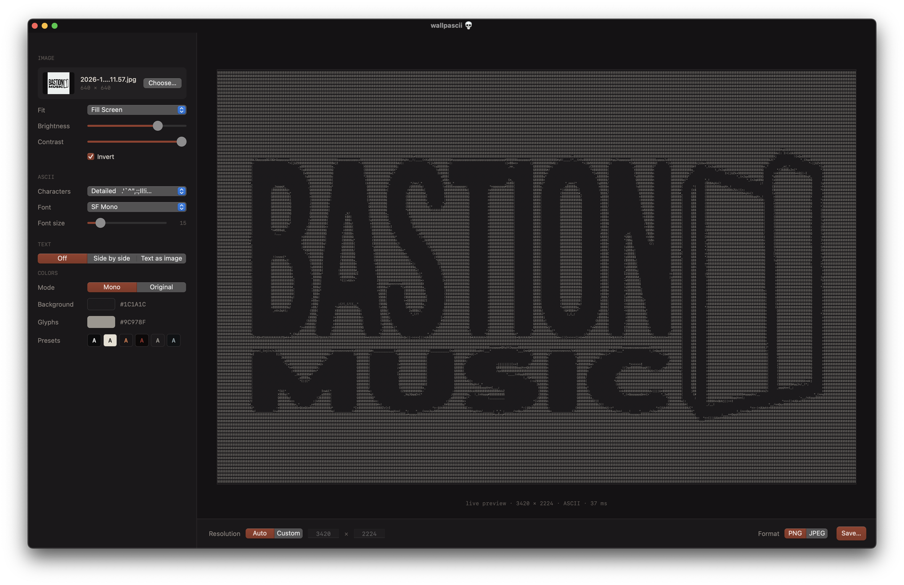
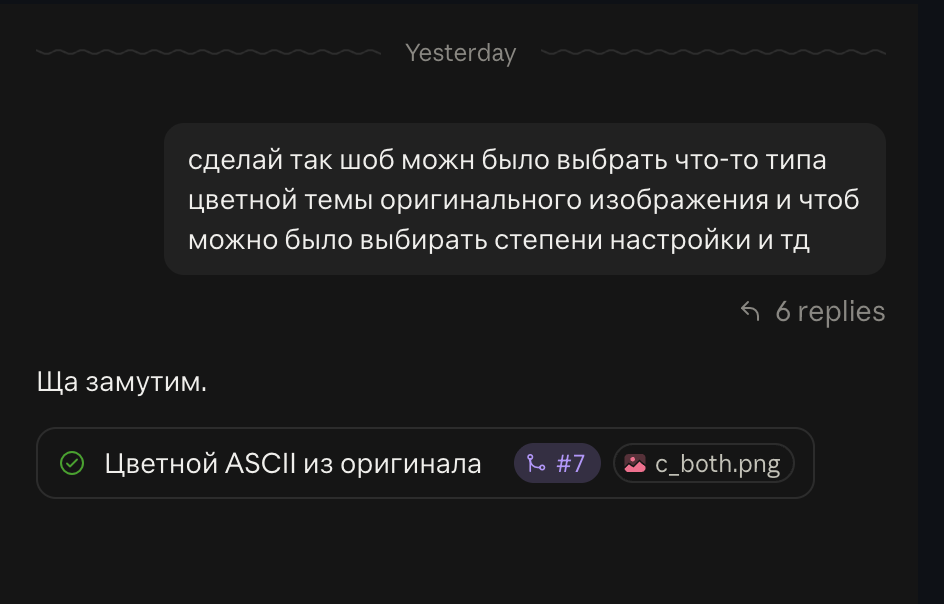

# wallpascii
A ASCII-wallpaper generator from photos/text



*macOS app. Native apps for macOS (Apple Silicon) in `macos/` and Windows 10/11 in `windows/`.*

## По-русски

Кидаешь фотку, получаешь ASCII-обои ровно под свой экран. Работает нативно на маке и винде, никакого йобаново электрона.

Чё умеет:

- любую фотку (jpeg, png, heic, webp) в символы, набор символов свой или готовый, вплоть до `░▒▓█`
- превью сразу в полном разрешении, чё видишь то и сохранишь
- яркость, контраст, инверт, Fill/Fit/Stretch/Center
- цвета прям из фотки: красишь символы, фон или всё сразу, крутишь насыщенность
- текст сбоку от картинки или картинку самим текстом
- пресеты палитр или свои цвета
- сохраняешь в png/jpeg, плюс есть CLI для любителей терминала

Где взять: на винду качаешь [`bin/wallpascii.exe`](bin/wallpascii.exe) и запускаешь, ставить ничего не надо. Остальные сборки лежат в [Releases](https://github.com/dethteq/wallpascii/releases).

Хоткеи на винде: `Ctrl+O` открыть, `Ctrl+S` сохранить, даблклик по слайдеру сбрасывает его.

### Процесс создания



*процесс создания*

## Building

Requires CMake 3.20+ and a C++17 compiler (Xcode command line tools on macOS, Visual Studio 2022 on Windows).

```bash
cmake -S . -B build -DCMAKE_BUILD_TYPE=Release
cmake --build build --parallel
ctest --test-dir build --output-on-failure
```

## macOS app

On macOS the same build also produces `build/macos/wallpascii.app` (needs only the Xcode command line tools):

```bash
open build/macos/wallpascii.app
```

Choose or drop a photo (JPEG, PNG, HEIC…), tweak the settings, and the preview updates live at the full output resolution. Glyphs are drawn with system fonts through Core Text; settings are remembered between launches.

## Windows app

A prebuilt Windows exe is in [`bin/wallpascii.exe`](bin/wallpascii.exe) (x64, Windows 10/11, no install). Ready-made builds are also on the [Releases](https://github.com/dethteq/wallpascii/releases) page: pushing a `v*` tag builds the Windows exe and the macOS app and attaches them. On Windows the build also produces `build/windows/Release/wallpascii.exe`, a single portable exe (Visual Studio 2022, static runtime); CI uploads it on every PR as the `wallpascii-windows-x64` artifact.

Same features as the macOS app: drop or choose a photo (JPEG, PNG, plus HEIC/WebP/TIFF/BMP through Windows Imaging), live full-resolution preview, side-by-side text, original photo colors. Glyphs are drawn with installed monospace fonts (Cascadia Mono, Consolas, …) through DirectWrite; the UI is custom-drawn with Direct2D in the same dark theme; settings and the window position are remembered in `HKCU\Software\wallpascii`. `Ctrl+O` opens a photo, `Ctrl+S` saves, double-click a slider to reset it.

## CLI

The core is GUI-independent; `wallpascii-cli` drives it and renders with a built-in 8×8 bitmap font (the apps will use system fonts via Core Text / DirectWrite).

```bash
./build/cli/wallpascii-cli -i photo.jpg -o wallpaper.png --size 2560x1600 --charset detailed --invert
./build/cli/wallpascii-cli -i photo.jpg -o wallpaper.jpg --mode text --text "hello " --bg "#101418" --fg "#9FE3C2"
./build/cli/wallpascii-cli -i photo.jpg -o wallpaper.png --mode side --layout right --align left --text-file quote.txt
./build/cli/wallpascii-cli -i photo.jpg -o wallpaper.png --color original --color-target both --saturation 1.3
```

Run `wallpascii-cli --help` for all options (fit mode, brightness, contrast, charset, font size, colors, original photo colors, format, side-by-side layout).

`--color original` takes each cell's color from the photo. `--color-target` picks what it paints (glyphs, the cell background, or both), `--color-strength` mixes it with `--fg`/`--bg`, and `--saturation` / `--color-brightness` tune it.

## Layout

- `core/` — C++17 library: photo loading (stb_image, EXIF orientation), Fill/Fit/Stretch/Center, brightness/contrast/invert, brightness → ASCII grid, original photo colors per cell, text-as-image, side-by-side text layout, rendering, PNG/JPEG export (stb_image_write)
- `macos/` — AppKit app (Objective-C++), Core Text glyph rasterizer
- `windows/` — Win32 app (C++), DirectWrite glyph rasterizer, Direct2D UI, WIC photo loading
- `cli/` — command-line driver
- `tests/` — unit tests (CTest)
- `third_party/` — vendored public-domain headers: stb_image, stb_image_write, font8x8
